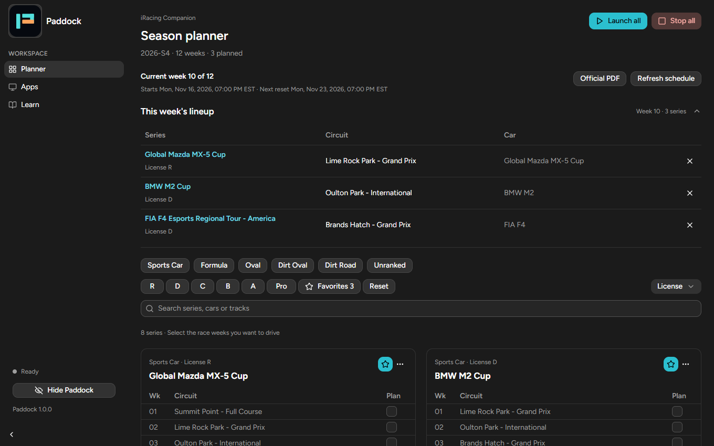
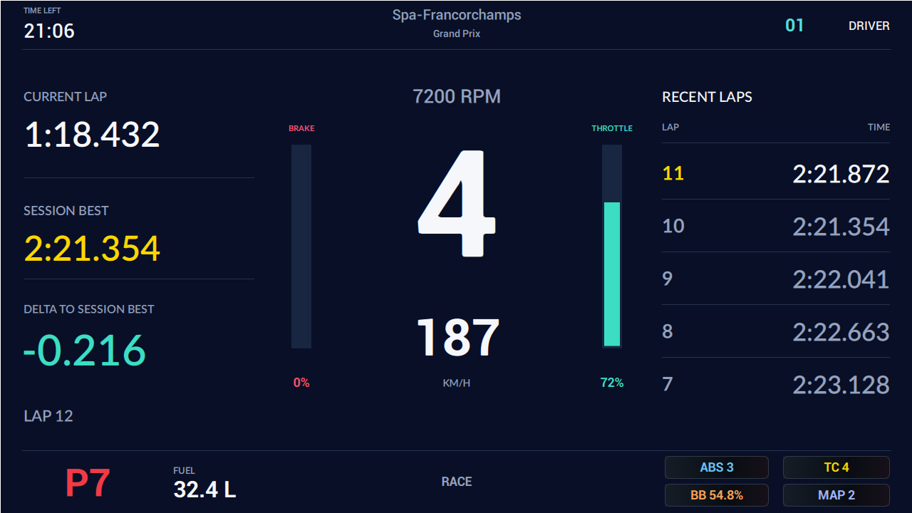

# Paddock · iRacing Companion

Plan your iRacing week and bring your companion apps together. Paddock is a Windows app for choosing what to race, keeping a weekly lineup and launching the setup you want to use. The optional Paddock CM2 dashboard brings a matching, focused display to the MOZA CM2.

**[See the website and demos](https://coolofficials.github.io/paddock/)** · **[Download the latest release](https://github.com/coolofficials/paddock/releases/latest)** · **[Report an issue](https://github.com/coolofficials/paddock/issues)**

[](https://coolofficials.github.io/paddock/#app-demo)

## Two downloads, two jobs

| Package | What it does | What you need |
|---|---|---|
| [Paddock for Windows](https://github.com/coolofficials/paddock/releases/download/v1.0.1/Paddock-1.0.1-Windows-x64.zip) | iRacing season planning and companion-app management | Windows x64 and Microsoft Edge WebView2 Runtime |
| [Paddock CM2](https://github.com/coolofficials/paddock/releases/download/v1.0.0/Paddock-CM2-1.0.0.zip) | Native dashboard for the MOZA CM2 | MOZA CM2, SimHub and AZOM; DNR integration for recent-lap history |

The app and dashboard can be used independently. Paddock does not install the companion apps, SimHub, plugins or hardware drivers for you.

## Plan the week

- Refresh the official iRacing schedule and browse the season in one continuous list.
- Favorite the series you want near the top, and check Plan on the weeks you want to drive.
- See your selected current-week series, circuits and cars in a collapsible lineup.
- Select a lineup name to jump to its schedule. Filtered-out destinations are revealed before navigation.
- See race-week boundaries in your computer's local timezone.

A new installation starts without a downloaded schedule. Use **Refresh schedule** to get the official schedule. Refreshing the same season keeps its plans. Moving to a new season removes old Plan selections and undo history while retaining series favorites and app profiles.

## Bring the setup

- Use profiles to group app lists and launch preferences.
- Add programs found at known default locations, or browse to any supported executable.
- Choose **Window** or **Background** for each app.
- Use **Launch all**, **Stop all**, **Hide all windows** and **Show all windows** for the included apps.

The detection catalog covers iRacing UI, SimHub, Edge Overlays, Trading Paints, Garage 61, Crew Chief, GO Fast and MOZA Pit House. Discovery only checks known default paths and never adds or runs programs automatically.

Once startup hiding is complete, reopening an app's management window leaves it visible. An optional per-app Advanced action can re-hide a management window after the game exits; it is **off by default**. This can help with apps such as Edge Overlays, but a window opened manually during the short re-hide interval may also be hidden. Trading Paints retains a two-second startup wait to let its initial window and tray setup finish.

Closing the iRacing UI or simulator does not stop your companion apps. Use **Stop all** when you want to close the included apps. Background mode hides windows; it cannot add a native tray icon to an app that does not have one. Unknown apps may need manual adjustment.

## Install the Windows app

1. Download and extract `Paddock-1.0.1-Windows-x64.zip` into a writable folder.
2. Keep `paddock.exe` and `WebView2Loader.dll` together.
3. Open `paddock.exe`. Visit **Apps** to create your setup, then **Planner** to refresh the schedule.

Paddock uses the [Microsoft Edge WebView2 Runtime](https://developer.microsoft.com/microsoft-edge/webview2/). It does not require Node.js or a local server to run. Keep the app's `data` folder when updating: it contains your local profiles, preferences and plans. Personal app data is not included in release archives.

## Paddock CM2

[](https://coolofficials.github.io/paddock/#cm2)

The public CM2 package uses original Paddock branding and an editable driver identity. It includes an automatic idle screen, gear/speed/RPM, brake and throttle bars, position, fuel and car-setting readouts, temporary central notifications and recent lap numbers/times when the required telemetry is available.

1. Prepare your MOZA CM2 connection in SimHub with AZOM.
2. Extract the dashboard package and locate `Paddock CM2.mzdash` (no external resources required).
3. Follow the package README to apply its channel mappings. Recent laps require the supported DNR integration.
4. Upload the dashboard through AZOM's CM2 device file manager, select it on the display and enable dashboard telemetry.

Available values depend on the car, session and telemetry source. Demo footage uses simulated telemetry and is not a recording of live driving. Consult [the CM2 documentation](cm2/) for the package, mappings, source and license details.

## Source and licenses

Paddock's original app code is available under the MIT license. Third-party dependencies and fonts retain their own licenses and notices. The CM2 tooling/materials have their own GPL-3.0 licensing scope; see the license documentation in `cm2/`. See [third-party notices](THIRD_PARTY_NOTICES.md) before redistributing packages.

Paddock is an independent companion project and is not affiliated with or endorsed by iRacing, MOZA or the companion apps named above. Product names identify compatibility.

## Build the app

Use Windows x64, Node.js 22.13+ with npm, Rust 1.90.0 GNU and MinGW-w64 (gcc and windres on PATH). Alternatively run `app/scripts/setup.ps1` for the pinned project-local toolchain.

```powershell
cd app/frontend
npm ci
npm run build
npm test # requires installed Google Chrome (channel chrome)
cd ..
./scripts/cargo.ps1 test --locked
./scripts/cargo.ps1 build --release --locked
node scripts/dependency-notices.cjs
./scripts/package.ps1
```

UI tests use an installed Google Chrome browser. The frontend is embedded at compile time; build it before Cargo. The app does not require npm or a server when installed. Tests and demo footage use hand-authored synthetic schedules, not a bundled official season. The Windows executable is unsigned.

Release packaging runs a binary privacy check. scripts/cargo.ps1 remaps source paths to virtual paths; scripts/verify-release-privacy.cjs rejects executables or DLLs containing local home paths.
