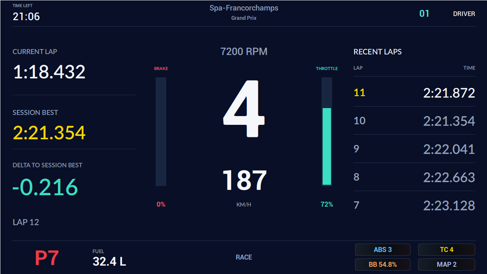

# Paddock CM2

A focused, single-page dashboard for the MOZA CM2. One driving view, an automatic idle screen, and clear temporary alerts.



## What it shows

- RPM above the gear and speed, with separate brake and throttle bars.
- Current lap, session best and delta, plus five recent lap numbers and times when a lap-history provider is configured.
- Position, fuel, ABS, TC, brake bias and ECU map.
- Session time remaining; qualifying completed/limited laps when supplied by the game.
- Circuit and layout on separate lines.
- Large temporary setup-change, flag and pit/limiter messages.
- An automatic Paddock idle screen with your driver name and number.

Throttle and brake values use the native 0–1 range: `0.77` displays as `77%`. This dashboard does not display tyre temperature.

## Requirements

Windows, a MOZA CM2 (1280 × 720), SimHub and a compatible [AZOM plugin](https://giant.orth.cc/). MOZA Dashboard Studio can edit the native `.mzdash` file. The Paddock desktop app is independent: you can use either product on its own.

The five recent-lap rows use `DNRLEDs.Data.Last7LapsData` through the supplied mapping file. A compatible DNR lap-history provider must expose that property in SimHub. Without it, recent-lap rows show placeholders; the rest of the dashboard remains usable. No DNR software is bundled. You may adapt the mapping formulas to another lap-history source.

## Install

1. Download and extract the CM2 release ZIP.
2. Configure the 11 Paddock-specific channel mappings in `Paddock CM2.history-mappings.json`. `MapAllowed` transports `DataCorePlugin.GameRunning`; the other ten slots transport five lap times and five lap numbers. The temperature-named slots are transport slots for this dashboard, not temperature displays.
3. You can apply the mappings with `Apply-Mappings.ps1`: first fully exit SimHub, then run the script in PowerShell. It backs up the AZOM settings and changes Paddock dashboard mappings only. Use `-WhatIf` or `-PreviewPath preview.json` to inspect its proposed changes. The default SimHub location is `C:\Program Files (x86)\SimHub`; pass `-SimHubRoot` if yours differs. If several CM2 devices are configured, apply the mapping JSON manually in AZOM instead of using the helper.
4. Open SimHub → Devices → MOZA CM2 → Files. Pick the local `Paddock CM2.mzdash`, upload it, select it and enable dashboard telemetry.

See the [AZOM dashboard/channel guide](https://giant.orth.cc/guides/dashboard-and-channels/) and [wheel-file guide](https://giant.orth.cc/guides/wheel-files/).

## Make it yours

The default identity is **YOUR NAME / 01** on the idle view and **DRIVER / 01** while driving. You can change the native text nodes in MOZA Dashboard Studio, or use the included Node.js helper:

```powershell
node customize.cjs --name "ALEX DRIVER" --short-name "ALEX" --number "27" --output "My Paddock CM2.mzdash"
```

The helper writes a new file and keeps the original unchanged. Keep the internal dashboard name `Paddock CM2` so its AZOM mapping keys continue to match. There are no external image resources: the public Paddock graphics are native shapes and text.

## Demo and verification

[Watch the dashboard demo](demo.mp4). It uses the actual dashboard's native MOZA Studio renderer with simulated telemetry values. It is not a recording of a physical CM2 or a live iRacing session. Device upload, firmware behavior and an actual race session remain hardware checks for your own rig.

Public branding, automatic idle behavior and eight sample scenarios were rendered and inspected. Every telemetry binding was evaluated for those scenarios; details are in `verification.json`.

## License and credits

Files in this directory are distributed under **GPL-3.0**; see [LICENSE](LICENSE) and [SOURCE-NOTICE.md](SOURCE-NOTICE.md). The desktop app has its own licensing scope. AZOM, SimHub, MOZA and iRacing are separate projects/products; no affiliation or endorsement is implied.
